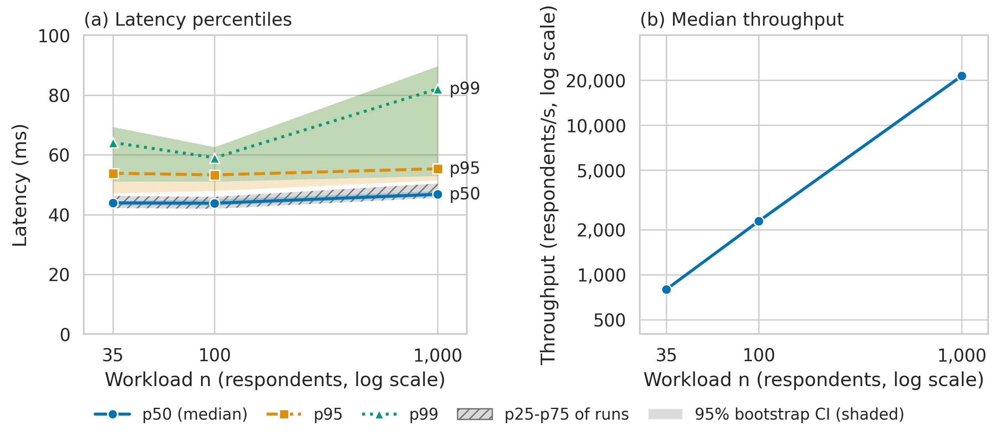
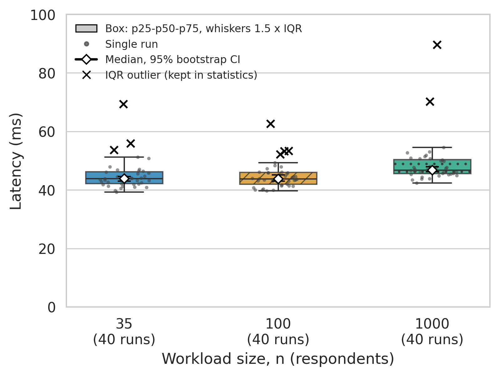
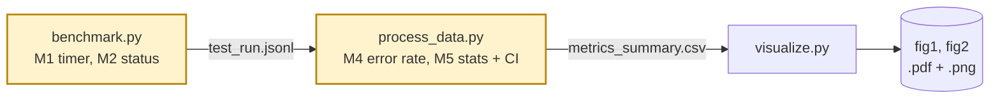

# Professional Burnout of Teachers in Private and State Schools


**Authors:** Zhanat, Yergali
**Repository:** https://github.com/Zhanb089/teacher-burnout-study

## Overview

This repository contains the analysis pipeline for a quantitative cross-sectional study that compares
burnout among teachers of state and private schools and examines which working conditions are related to it.
Burnout is measured with the Maslach Burnout Inventory in the Russian adaptation by Vodopyanova and
Starchenkova (three scales: emotional exhaustion, depersonalization, reduced professional accomplishment).

**Research question.** Do teachers in state and private schools differ in burnout, and which working
conditions explain the difference?

| | H0 | H1 |
|---|---|---|
| RQ1 | Burnout does not differ between school types | Burnout levels differ between state and private school teachers (main comparison: emotional exhaustion) |
| RQ2a | No working condition is related to emotional exhaustion | At least one working condition is related to emotional exhaustion |
| RQ2b | The difference between school types does not become smaller when working conditions are controlled | The difference between school types becomes smaller when working conditions are controlled |
| RQ3 (exploratory) | The strength of each relation does not depend on school type | Class size and reporting matter more in state schools; parental pressure and job insecurity matter more in private schools |

The full methodology (variables, metrics, baseline, validity threats) is in
[`docs/methodology_card.md`](docs/methodology_card.md) (in Russian).

Primary metric: emotional exhaustion score (EE, 0-54). Guardrails: Cronbach's alpha >= 0.7 for every
scale and at least 15 complete questionnaires per group.

## Repository structure

```
teacher-burnout-study/
├── README.md
├── LICENSE
├── Dockerfile               # pinned base image, runs the pipeline
├── requirements.txt         # exact dependency versions
├── requirements-notebook.txt# + Jupyter, only needed to re-run the notebook
├── config.yaml              # all experiment parameters
├── data/
│   ├── sample/              # 8 fictional rows to test the pipeline
│   ├── raw/
│   │   └── test_run.jsonl   # measurement log: 10 warm-up + 120 timed + 30 edge runs (fictional data)
│   └── processed/
│       ├── metrics_summary.csv  # median, p95, p99, mean, SD, 95% bootstrap CI per workload
│       ├── runs_clean.csv       # one row per measured run, with outlier flags
│       └── edge_cases.csv       # outcome of each edge-case scenario
├── docs/
│   ├── domain_model.md      # C4 model (context, containers, components) with metric collection points
│   └── methodology_card.md  # methodology passport card
├── notebooks/
│   └── 01_data_analysis.ipynb   # executed notebook: ingestion, statistics, figures
├── reports/
│   └── figures/             # fig1_latency_vs_load, fig2_distribution_boxplot (.pdf + .png 300 DPI), captions.md
├── src/
│   ├── benchmark.py         # scoring, guardrails, RQ1-RQ3 analysis + measurement harness (--bench)
│   ├── process_data.py      # cleaning, warm-up filter, error-rate guardrail, statistics, bootstrap CI
│   └── visualize.py         # final publication figures
└── results/                 # run_log.txt and summary.json (generated, not committed)
```

## Results & Discussion

The pipeline itself was benchmarked: how do latency and throughput of the analysis script change with the number
of processed respondents? All numbers come from `data/raw/test_run.jsonl` (fictional respondents, one machine,
seed 42): 10 warm-up runs discarded, 40 measured runs per workload, 0 of 120 runs failed (error-rate guardrail).
The notebook [`notebooks/01_data_analysis.ipynb`](notebooks/01_data_analysis.ipynb) reproduces every number.

**Baseline** is the smallest workload (n = 35). The larger workloads are
*conditions* of the same script, not competing methods, so there is no separate "proposed method" row.

| Workload n | Latency, ms: median (p25-p75) | p95, ms [95% CI] | p99, ms [95% CI] | Throughput, resp./s: median (p25-p75) | Speed-up S(n) |
|---|---|---|---|---|---|
| 35 (baseline) | 43.9 (42.2-46.2) | 53.8 [47.1, 69.3] | 64.1 [51.1, 69.3] | 797 (758-830) | 1.00 |
| 100 | 43.8 (41.9-45.9) | 53.3 [48.0, 62.6] | 59.0 [51.1, 62.6] | 2,283 (2,177-2,384) | 2.86 |
| 1000 | 46.8 (45.6-50.4) | 55.3 [51.5, 89.7] | 82.1 [53.0, 89.7] | 21,371 (19,850-21,923) | 26.8 |

Latency is right-skewed, so medians and percentiles are reported; mean ± SD is in
[`data/processed/metrics_summary.csv`](data/processed/metrics_summary.csv). Confidence intervals are percentile
bootstrap (10,000 resamples, seed 42).



*Figure 1. (a) Latency percentiles with 95% bootstrap CI (coloured) and p25-p75 of the runs (grey hatched).
(b) Median throughput, log scale.*



*Figure 2. Single runs per workload; box = p25/p50/p75; diamond = median with 95% CI; crosses = IQR outliers (kept).*

**Discussion.**

- The median latency stays at 44-47 ms while the workload grows 28 times; throughput grows 26.8 times
  (efficiency E(1000) = 0.94). The cost of a run is mostly a fixed overhead.
- 35 and 100 respondents cannot be told apart (the intervals of the medians overlap); 1000 respondents is about
  3 ms slower and its interval does not overlap theirs.
- p99 is the least certain value: with 40 runs it depends on the one or two slowest runs, hence the wide interval.
- Limits: one machine and container, synthetic respondents, sequential runs, three workload sizes.

## Domain model

The C4 model (system context, containers, components of the benchmark harness and of the data processor, domain
entities) with the **metric collection points M1-M5** is in [`docs/domain_model.md`](docs/domain_model.md).
Short version of the data flow:



## Reproduce the results

```bash
pip install -r requirements.txt
python src/process_data.py      # raw log -> data/processed/*.csv   (warm-up removed, bootstrap seed 42)
python src/visualize.py         # -> reports/figures/fig1_*.{pdf,png}, fig2_*.{pdf,png}

# notebook (re-run everything): Kernel -> Restart & Run All
pip install -r requirements-notebook.txt
jupyter nbconvert --to notebook --execute --inplace notebooks/01_data_analysis.ipynb
```

## Planned analyses

| Question | Method | Reported metrics |
|---|---|---|
| RQ1 | Welch t-test; Mann-Whitney U if not normal | group means, p, Cohen's d |
| RQ2 | Spearman correlations (hierarchical regression is run in JASP) | rho, p; beta, R², delta R² |
| RQ3 | Spearman correlation within each school type | rho per group |
| Quality | Cronbach's alpha, group sizes | alpha per scale, n per group |

Expected output on the sample (the data are fictional, 4 rows per group, so the numbers only prove that
the pipeline runs; the group-size guardrail correctly reports FAIL):

| Scale | Mean (state) | Mean (private) | Cohen's d |
|---|---|---|---|
| EE | 38.75 | 19.00 | 2.676 |
| DP | 10.25 | 3.75 | 1.481 |
| RPA | 23.00 | 33.50 | -1.513 |

## Reproducibility checklist

- [x] Exact dependency versions (`requirements.txt`, pinned base image)
- [x] Fixed random seed in `config.yaml`
- [x] All analysis and load parameters in `config.yaml`
- [x] Measurement log with warm-up runs separated from timed runs (`data/raw/test_run.jsonl`)
- [x] Sample data to test the pipeline
- [x] One command to build and one to run
- [x] Raw log, processing script, executed notebook, final figures (`.pdf` + 300 DPI `.png`), domain model
- [ ] Real survey data analysed

## Data note

The sample data are fictional. The real survey is anonymous (no names, no school names); raw exports are
not committed (see `.gitignore`).

## Citation

```bibtex
@misc{teacher_burnout_schools_2026,
  title  = {Professional Burnout of Teachers in Private and State Schools},
  author = {Zhanat and Yergali},
  year   = {2026},
  url    = {https://github.com/Zhanb089/teacher-burnout-study}
}
```

## License

MIT, see [LICENSE](LICENSE).
