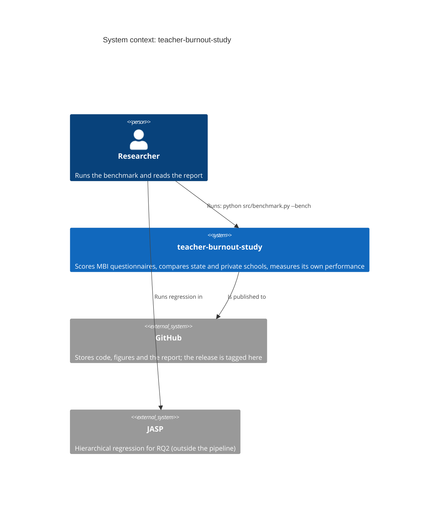
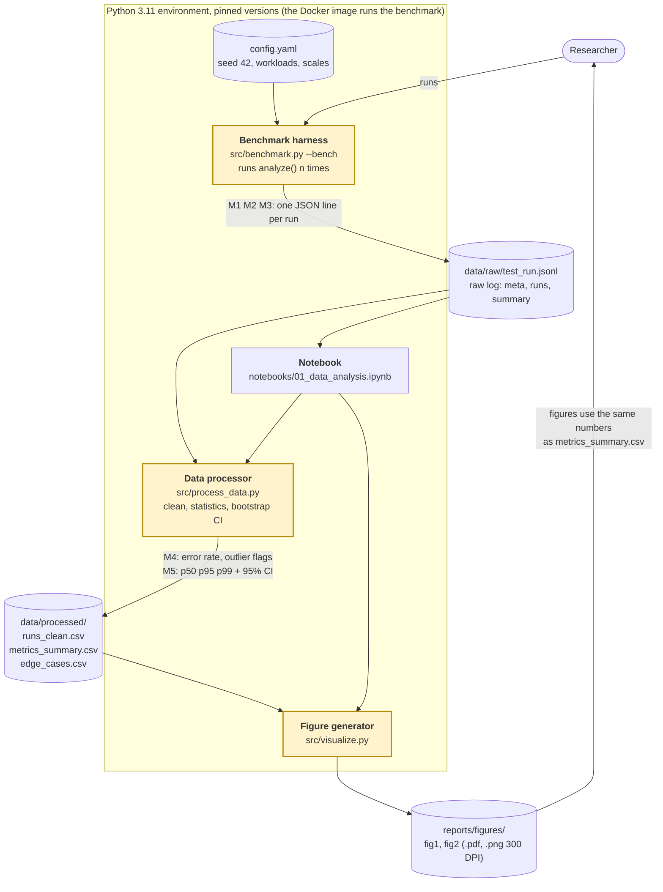
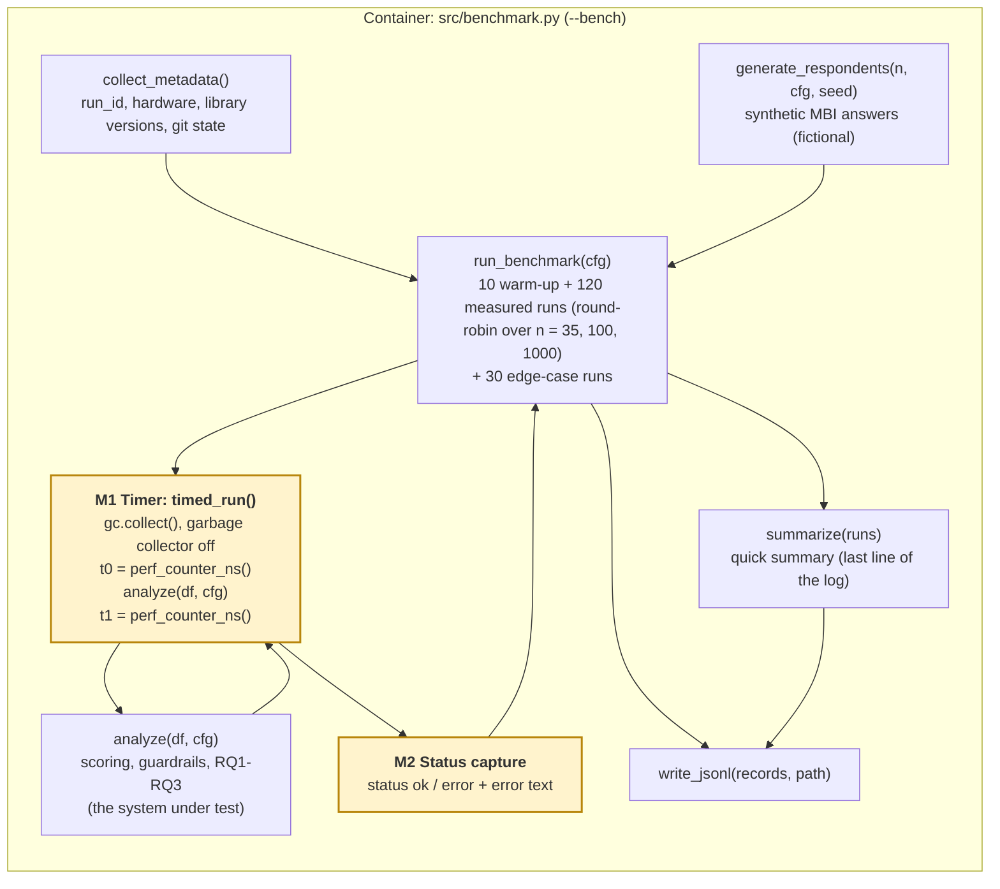
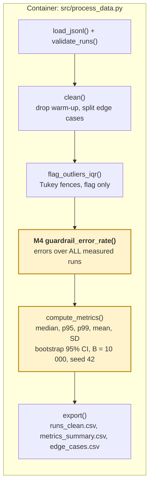
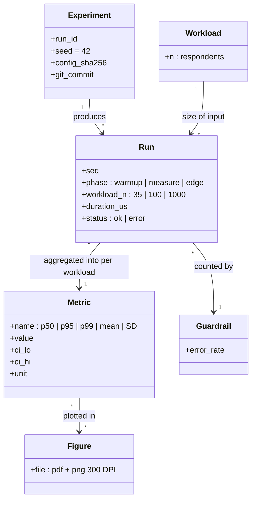

# Domain model (Software Engineering track): C4 diagrams

This document describes the measured system as a C4 model (levels 1-3) and marks the **metric collection
points** (M1-M5). It is written in [Mermaid](https://mermaid.js.org/), which GitHub renders directly.

## 1. System in one sentence

A researcher runs a Python analysis pipeline over a questionnaire (MBI, Maslach Burnout Inventory) answered
by teachers of state and private schools. To be sure the pipeline is fast and does not fail, a benchmark
harness runs it repeatedly for 35, 100 and 1000 respondents, records the time of every run, and turns the
log into statistics and figures.

## 2. Level 1: System context

## 3. Level 2: Containers (where metrics are collected)

Containers are separately runnable or storable parts. Highlighted nodes `M1`-`M5` are the **metric collection
points** described in section 5.

## 4. Level 3: Components of the benchmark harness

The harness `src/benchmark.py` is where raw measurements are created. The timer wraps **only** the analysis
call: data generation, the copy of the input table and writing the log are outside the two stopwatch marks,
and garbage collection is switched off during the call so that a random collection pause does not appear as a slow run.

### Components of the data processor

## 5. Metric collection points

| Id | Where (component) | What is measured | Unit | How | Stored in |
|---|---|---|---|---|---|
| **M1** | `timed_run()` inside `run_benchmark()`, timer around `analyze()` | Duration of one run, `duration_us` | µs (converted to ms) | `time.perf_counter_ns()` before and after (monotonic clock) | raw log, field `duration_us` |
| **M1b** | `timed_run()` | Start time of the run | µs since epoch | `time.time_ns()` | raw log, field `ts_start_us` |
| **M2** | `timed_run()`, `try/except` | Outcome of the run | ok / error | exception caught, text stored, run is **not** dropped | raw log, fields `status`, `error` |
| **M3** | `run_benchmark()` schedule | Phase and workload | warmup / measure / edge; n | counters per run | raw log, fields `phase`, `workload_n`, `seq` |
| **M4** | `guardrail_error_rate()` | Error rate (guardrail metric) | share, 0-1 | errors / all measured runs, overall and per workload | `metrics_summary.csv`, column `error_rate` |
| **M5** | `compute_metrics()` | Latency p50, p95, p99, mean, SD; throughput; 95 % CI | ms; respondents/s | percentile bootstrap, 10 000 resamples, seed 42 | `metrics_summary.csv` |

Derived quantities (formulas in the paper section 3): throughput θ = n / (duration in s), speed-up
S(n) = θ̃ₙ / θ̃ₙ₀ and efficiency E(n) = S(n) / (n / n₀) with baseline n₀ = 35.

## 6. Domain entities

## 7. Design decisions that protect the measurement

| Decision | Reason |
|---|---|
| Monotonic clock `perf_counter_ns` | Wall-clock time can jump (NTP) and would corrupt a duration |
| Garbage collector off while timing (`gc.collect()` before each run) | A collection pause in the middle of a run would look like a slow run and inflate the tail |
| Warm-up runs are recorded but excluded | Cold start (imports, caches) is not steady-state behaviour |
| Errors are kept and counted | Dropping failed runs would bias latency (selection bias) |
| Outliers are flagged, not deleted | They are real slow runs; median and percentiles are robust to them |
| Fixed seed 42, pinned Docker image and libraries | Same input gives the same numbers on another computer |
| Raw log is committed, processed files are derived | Every number can be recomputed from `data/raw/test_run.jsonl` |

## 8. Limitations of the model

The model describes one machine and one container image. Respondents are synthetic, so the data show how the
pipeline behaves, not real burnout results. Runs are sequential, so concurrent load is not modelled.
